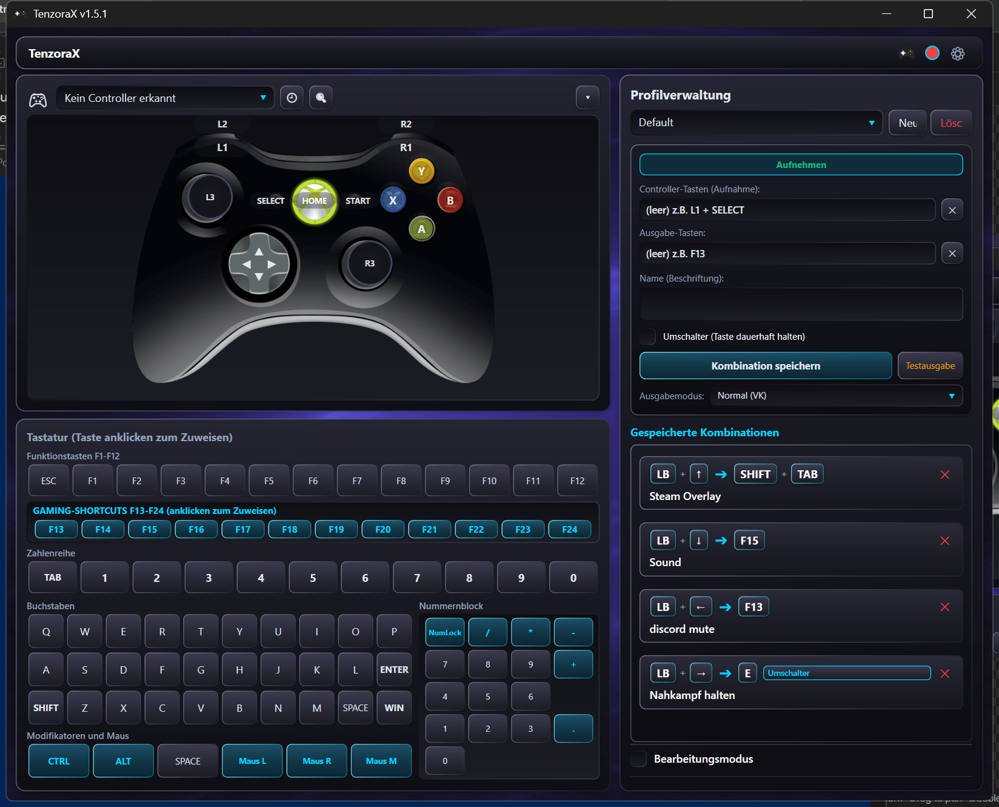

# TenzoraX

TenzoraX turns your game controller into keyboard and mouse actions – great for games, emulators, or your own custom shortcuts.

Free to use for everyone (MIT license).

---

## How it works

TenzoraX reads the controller through HID, DirectInput, XInput and Raw Input, merges the reports into one device view, and sends the mapped keyboard or mouse action with `SendInput`. Optional Xbox 360 mirroring uses ViGEmBus; HidHide can hide the physical controller from games.

## Installation

1. Download the latest version from [Releases](https://github.com/Arimtak/TenzoraX/releases).
2. Extract the ZIP to any folder.
3. Run `TenzoraX.exe` – no installation required.

> Note: The ZIP contains only the app. The required drivers are downloaded by the app itself (see below).

## Installing the drivers

On first launch you'll see a **status dot** in the top-right of the window:

- 🔴 **Red** = drivers are missing → click it once.
- 🟢 **Green** = drivers are installed – everything is ready.

The app then downloads the drivers (ViGEmBus + HidHide) automatically to `Documents\TenzoraX\drivers` and starts the installation.

## Usage

1. Connect your controller (USB, Bluetooth, or 2.4 GHz).
2. In the main window, click a button on the gamepad (e.g. A, B, LB, RB …).
3. Assign the desired key combination or mouse action on the right.
4. Click **Save** – done.

More features:

- 🕘 **History** – shows every controller ever detected.
- 🔍 **Diagnostics** – checks whether inputs are being received.
- 🎮 **Controller icon in the header** – opens the Windows "Game Controllers" window.
- **Tray icon** – quick access to the app and current controller status.

## What's new in 1.5.1

- Controller view: buttons now sit exactly on the pad artwork, and the D-pad is drawn as one cross instead of four separate tiles.
- Xbox/Guide (HOME) button is now detected.
- New "Toggle (hold key permanently)" option in the mapping editor; held keys are released when the app closes.
- Cleaner right panel: no tab strip, no scrollbar on the saved-combinations list, and cards use the full width.
- The "Xbox 360 & HidHide" tab was removed from the window.
- Default look is now "Shine"; a design chosen under Settings → Design is remembered.
- Bug fixes and stability improvements.

## Data

All settings, profiles, and logs are stored under `Documents\TenzoraX\`.

## System requirements

- Windows 10 or newer (64-bit)

## Contributors

- [Arimtak](https://github.com/Arimtak) – creator and maintainer
- Codebuff – AI pair programmer

TenzoraX is developed with AI assistance. All changes are reviewed and tested by the maintainer.

## License

MIT – see [LICENSE](LICENSE). You are free to use, modify, and share this software.
